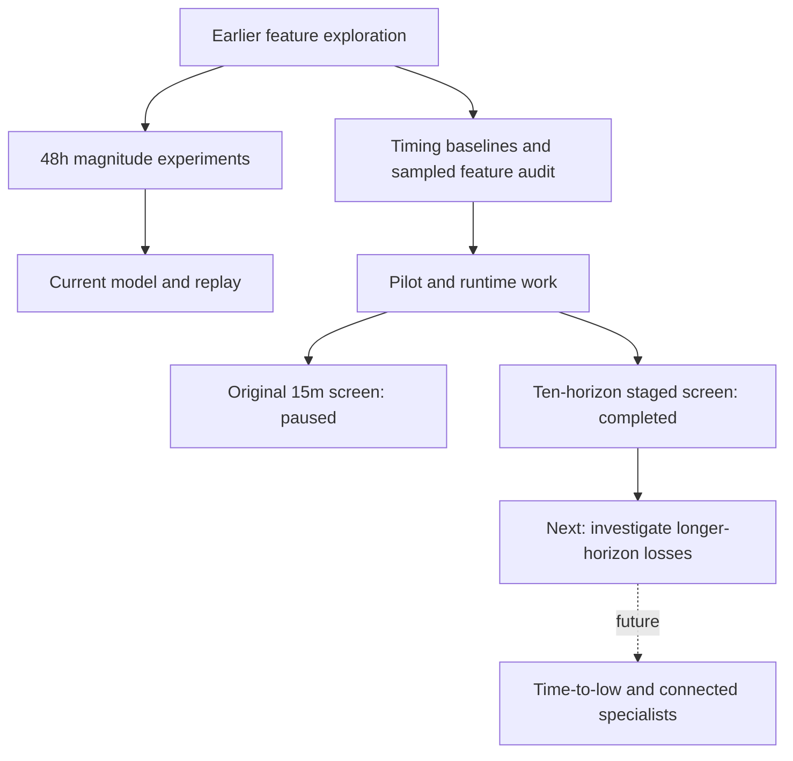

# ScaleWave BTC research

This repository explains what we tried, what worked, what did not, and what to investigate next.

**Main finding:** the 48-hour magnitude model improved modestly. Time-to-high models made small gains at shorter horizons but lost to simple baselines at longer horizons. These are research results, not proof of trading profit.

| Research | What it asks | Current position |
| --- | --- | --- |
| 48h magnitude | How large is the price change after 48 hours, ignoring its sign? | Current MAE **180.798518 log bps**, down from **182.036977** |
| Time to high | How many minutes until the highest price within the forecast window? | Ten horizons completed; mixed results |
| Earlier feature exploration | Which supplied measurements look associated with large BTC moves? | Historical notebooks and supporting evidence |
| Connected models | Can specialist models work together? | Future work; not implemented |

## Start here

| I want to... | Open |
| --- | --- |
| Read a short explanation | [Research summary](reports/research_summary.md) or [shareable PDF](reports/research_summary.pdf) |
| See what improved and failed | [Magnitude results](reports/magnitude_results.md), [timing results](reports/timing_results.md) |
| Understand targets and units | [Target definitions](docs/target_definitions.md) |
| Inspect the code | [Magnitude](research/magnitude_48h/README.md), [timing](research/time_to_high/README.md), [earlier exploration](research/feature_exploration/README.md) |
| Check results or replay models | [Reproducibility](docs/reproducibility.md) |
| Continue the work | [Continue research](CONTINUE_RESEARCH.md) |
| Upload using a branch | [Step-by-step GitHub guide](docs/publishing_to_github.md) |
| Review exactly what is included | [Artifact manifest](artifacts/manifest.json), [packaging verification](results/packaging_verification.json) |

## How the work fits together

## What the status labels mean

| Label | Meaning |
| --- | --- |
| Completed | Saved evidence exists for the stated scope |
| Partial / paused | Only part of the intended work finished |
| Superseded | A later decision replaced this result or plan |
| Planned | Not run; not a result |

**MAE** means average absolute prediction error; lower is better. A **baseline** is a simple reference prediction. A **fold** is one dated training/evaluation period. A **receipt** is a saved record of a run or check.

## Important limits

- Magnitude was evaluated on 18,481 development rows, with repeated research decisions made on this history.
- Timing's local checks verify saved results. They do not independently replay the original data or fitted timing models.
- The timing reserve was excluded from that task, but earlier magnitude research used some of those dates.
- It remains unclear whether all supplied F4Z values were available at the time a forecast would have been made.
- Original data stays outside Git. Private Drive access requires separate permission.

See [validation](docs/validation_and_reserve.md), [limitations](docs/limitations.md), and [data access](docs/data_access.md). Original research files may contain older instructions; use this README and CONTINUE_RESEARCH.md for the current handoff.
