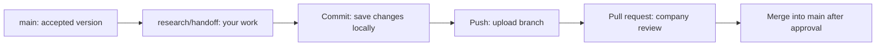

# Put this research on company GitHub

**Nothing has been uploaded. Confirm the company repository URL and final contents before any push command.** Use a private company repository. Do not upload the whole C:\ScaleWave folder.

## 1. Understand the words

| Word | Simple meaning |
| --- | --- |
| Repository | The project folder plus its saved change history |
| Git | The program that tracks changes on your computer |
| GitHub | The company website location where you share the repository |
| main | The team's accepted version |
| Branch | A separate line of changes you can prepare for review |
| Commit | A saved checkpoint of changes |
| Push | Upload your commits to GitHub |
| Pull request (PR) | Ask a colleague to review your branch before adding it to main |
| Merge | Add the reviewed changes to main |
| origin | A short name for the GitHub repository URL |

For this handoff, use **research/handoff** as the branch name. Later work can use names such as **research/long-horizon-followup**. A branch is not another dataset folder and does not require manually duplicating the research. GitHub describes this review workflow in its [branch guide](https://docs.github.com/en/pull-requests/reference/branches) and [pull-request quickstart](https://docs.github.com/en/pull-requests/get-started/pull-request-quickstart).



## 2. Confirm access first

Ask the company administrator for the exact repository URL, permission to push a branch, the required reviewer and branch rules. To create a new repository, you also need the organization's permission to create repositories. An existing repository needs its own agreed destination folder for this research. Company SSO or credential approval may also be required.

Use your approved GitHub sign-in method. For HTTPS, Git may open a browser through the credential manager; otherwise follow company-approved token authentication. A normal account password is not used for Git HTTPS authentication. Never put a token in a URL, script, README or commit. See [GitHub authentication](https://docs.github.com/en/authentication/keeping-your-account-and-data-secure/about-authentication-to-github).

Open **PowerShell**. Run commands one block at a time; if any command fails, stop and read the error before proceeding. Replace COMPANY_ORG and the example identity before use.

## 3A. NEW EMPTY company repository

Use this route only when the destination has **no commits**. In GitHub, select the company organization, name it scalewave-btc-research, select Private, and leave README, .gitignore and license initialization unchecked. Ask an administrator to do this if needed. GitHub's [local-code upload guide](https://docs.github.com/en/migrations/importing-source-code/using-the-command-line-to-import-source-code/adding-locally-hosted-code-to-github) explains the empty-remote setup.

The delivered folder is locally initialized on main, with no commits, no staged files and no remote. First check that state:

```powershell
Set-Location C:\ScaleWave\scalewave-btc-research
git status
git remote -v
```

Set your company-approved author details for **this repository only**. These are commit attribution, not a login:

```powershell
git config --local user.name "YOUR APPROVED NAME"
git config --local user.email "YOUR APPROVED EMAIL"
```

Create an empty starting commit on main. It contains no research files. This gives your review branch a starting point:

```powershell
git commit --allow-empty -m "Initialize research repository"
git switch -c research/handoff
git branch --show-current
```

The last command should print `research/handoff`. Now select and review the research files:

```powershell
git add .
git diff --cached --stat
git status
git diff --cached
```

Check the file list. Prepared X/y datasets, ZIP archives, credentials and unrelated documents must not appear. Binary models and the one retained prediction file are intentional and listed in the manifest. Press `q` to exit Git's diff viewer. The source-map and artifact manifest provide hashes for binary review.

Save the handoff locally:

```powershell
git commit -m "Document magnitude and timing research with reproducible handoff"
```

**Only after destination and final-content approval**, add the actual URL. Do not paste the placeholder unchanged:

```powershell
git remote add origin https://github.com/COMPANY_ORG/scalewave-btc-research.git
git remote -v
```

Check the organization and repository in the displayed URL. Then upload the empty main baseline and the research branch:

```powershell
git push -u origin main
git push -u origin research/handoff
```

If company rules prevent creating main by push, ask the administrator to initialize main and use route 3B. Do not force-push around company rules.

On GitHub, open **Pull requests → New pull request**. Choose **base: main** and **compare: research/handoff**. Use the title “Document magnitude and timing research”. Describe the contents, checks and known limits; request the company reviewer. Merge only after the required review. In repository settings, confirm main is the default branch and apply the company's branch protection rules if you have permission.

## 3B. EXISTING company repository, including one with an initial README

Do not push this local main history over an existing company repository. First agree on a new, unused destination subfolder and check the existing repository's contribution instructions.

Clone it inside the workspace. Use an unused local checkout path:

```powershell
Set-Location C:\ScaleWave
git clone https://github.com/COMPANY_ORG/EXISTING_REPO.git company-research-checkout
Set-Location C:\ScaleWave\company-research-checkout
git status
git remote show origin
```

The last command identifies the default branch. The example below assumes it is main; substitute the actual approved base branch if different:

```powershell
git switch main
git pull --ff-only
git switch -c research/handoff
```

If research/handoff already exists, agree on a new name instead of overwriting it. After inspecting repository instructions, copy the prepared package into an agreed **new** subfolder. This example refuses to overwrite an existing folder and excludes the prepared package's .git directory:

```powershell
$destination = 'C:\ScaleWave\company-research-checkout\scalewave-btc-research'
if (Test-Path -LiteralPath $destination) { throw 'Destination exists. Agree on an integration plan first.' }
New-Item -ItemType Directory -Path $destination
Get-ChildItem -LiteralPath 'C:\ScaleWave\scalewave-btc-research' -Force |
    Where-Object { $_.Name -notin @('.git', '.validation') -and $_.Name -notlike '.venv*' } |
    Copy-Item -Destination $destination -Recurse
```

Set your repository-local author identity if needed, then review and commit only this subfolder:

```powershell
git add -- scalewave-btc-research
git diff --cached --stat
git diff --cached
git status
git commit -m "Add ScaleWave BTC research handoff"
```

After destination and final-content approval:

```powershell
git push -u origin research/handoff
```

Open a PR against the agreed base branch. Do not replace existing company files or use force push. This route creates a separate integration checkout only when needed; the original research remains untouched.

## 4. Make later changes

Once the handoff is merged, start future work from an up-to-date main:

```powershell
git switch main
git pull --ff-only
git switch -c research/long-horizon-followup
```

Make changes, check them, then use `git add`, `git commit` and `git push -u origin research/long-horizon-followup`. Open another PR. Branches keep unfinished research separate from the accepted handoff.

## File size and troubleshooting

See [package size](../results/package_size.json) for measured contents. Git metadata/history adds disk usage; future datasets and model versions can grow it. The PDF is a separate small summary, not the entire repository. No ZIP is needed for a normal Git push.

GitHub blocks individual regular-Git files above 100 MiB, warns above 50 MiB and limits browser uploads to 25 MiB per file. The packaged files are checked against these thresholds. See [GitHub file limits](https://docs.github.com/en/repositories/working-with-files/managing-large-files/about-large-files-on-github). Current small model files use ordinary Git; no Git LFS setup is required for this snapshot. Keep future large artifacts in approved storage and record their checksums instead of adding datasets to Git.

| Message | What to do |
| --- | --- |
| Repository not found / 403 | Check URL, company permission and SSO; private repositories can appear missing |
| Author identity unknown | Set the repository-local name/email shown above |
| Remote origin already exists | Inspect `git remote -v`; do not add a second origin or blindly replace its URL |
| Push rejected / non-fast-forward | Stop; the remote may already have commits. Follow the existing-repository workflow |
| Protected branch | Use the research branch and company PR process; ask an administrator about initial main setup |
| Nothing to compare in PR | Check base and compare branches; for a new empty repo, main needs its separate initial commit |

Do not initialize Git at C:\ScaleWave, use force push, or put credentials into commands.
